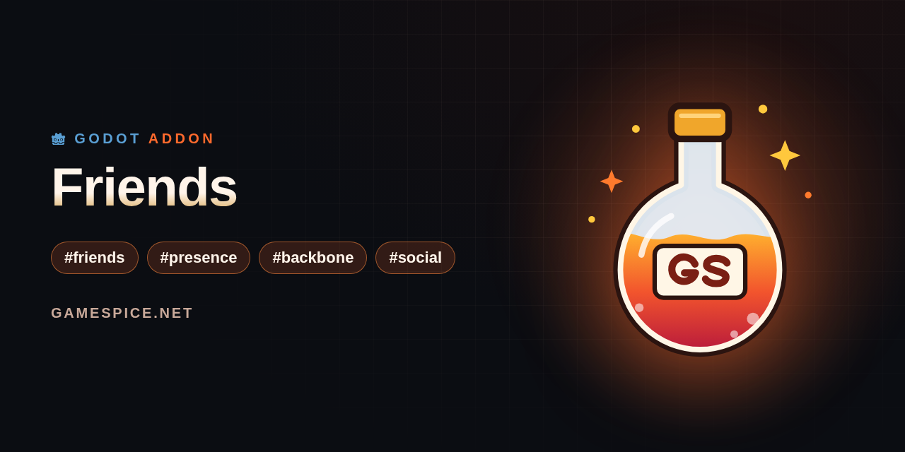

[](https://moddingcommunity.com/a/70-gs-friends)

A friends list for your game, wired to the TMC website: who is online, what they are playing, on which server and in which party, and a Join button that takes a player to where their friend is.

gs-friends is a [GameSpice](https://gamespice.net) addon under the MIT licence, built with Claude Code. Its headless suite is `examples/friends_selftest.tscn`. It is not a shelf library: the games in [Zee's Games](https://zeesgames.com) are built on the GameSpice addons and run on live servers, so the addons get used in real play.

## Install

Copy `addons/gs_friends/` and [GameSpice Core](https://github.com/gamespice-platform/core)'s `addons/gs_core/` into your project and enable gs-friends in **Project > Project Settings > Plugins**. gs-core is the only dependency. gs-auth, gs-party and your connect code are reached through callables and never named.

## Use

```gdscript
var friends := GSFriendsClient.new()
var app := GSFriendsBackendApp.new()
app.client = auth          # gs-auth's GSAuthClient: it holds the token and refreshes it
friends.backend = app
friends.join_party_fn = func(party_id: String, _friend: GSFriend) -> GSResult:
    return await party.join(party_id)          # a GSPartyClient, if the game has parties
friends.connect_fn = func(server_id: int, _friend: GSFriend) -> GSResult:
    return await game.connect_to_server(server_id)
add_child(friends)

friends.friend_online.connect(func(f: GSFriend): hud.toast("%s is online" % f.display_name))
friends.request_received.connect(func(r: GSFriendRequest): hud.toast("%s wants to be friends" % r.display_name))
party.joined_party.connect(func(p): friends.set_party(p.id))
```

## How it works

The website owns the friends list: requests, answers and unfriending all happen there. The game keeps a snapshot that is as fresh as its last poll.

| Backend | What it is |
| --- | --- |
| `GSFriendsBackendApp` | The website, as the signed-in player. |
| `GSFriendsBackendLocal` | The website's rules run in-process, for a LAN, an offline build and the tests. |

A refusal carries a reason key such as `friends.request.deny.pending` in `GSError.detail`, so a game can show its own text.

**Presence** is what friends see: offline, online, in game or away, which game, server and party, whether the player can be joined, and one line of text your game writes. `GSFriendsClient` posts it on a heartbeat (well inside the two minutes the website keeps it) and straight away on a change. A burst of changes goes out as one post. Call `go_offline()` when the player quits. A player who hides their activity on the website shows as offline to everyone.

**Joining.** `join(friend_user_id)` re-checks the friend's presence, then joins their party if it is joinable and the game can join parties, otherwise connects to their server if the game can, otherwise refuses with a reason (not a friend, offline, not joinable, or somewhere this game cannot follow).

## Signals

`friend_added`, `friend_removed`, `friend_online`, `friend_offline`, `friend_presence_changed`, `request_received`, `requests_changed`, `friends_changed`, `presence_posted`, `request_failed`. The first poll after launch only emits `friends_changed`, so there is no "came online" toast for every friend already playing. Pending requests are announced the first time they are seen.

## Test

```bash
godot --headless --path . --import
godot --headless --path . res://examples/friends_selftest.tscn
```

## Used by

No shipped game uses it yet; the self-test scene is the only place it runs.

The whole collection is at [zeesgames.com](https://zeesgames.com).

## Licence

MIT. See [LICENSE](LICENSE).
